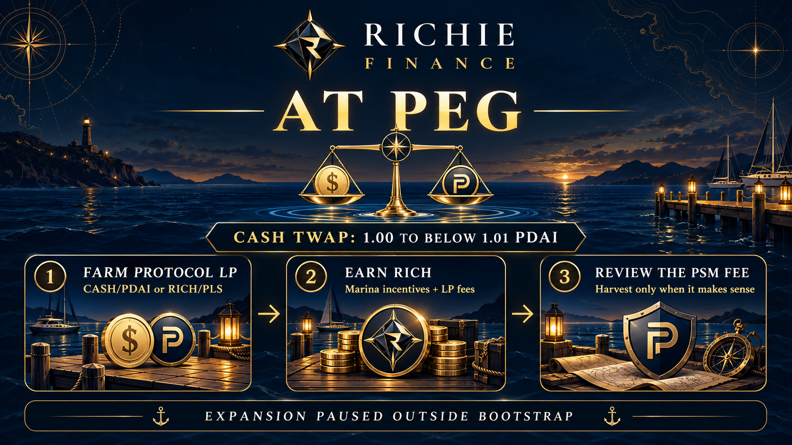
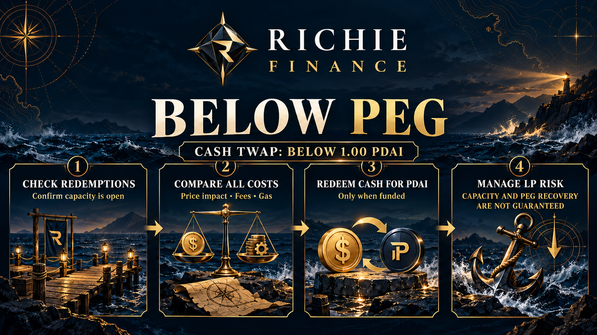
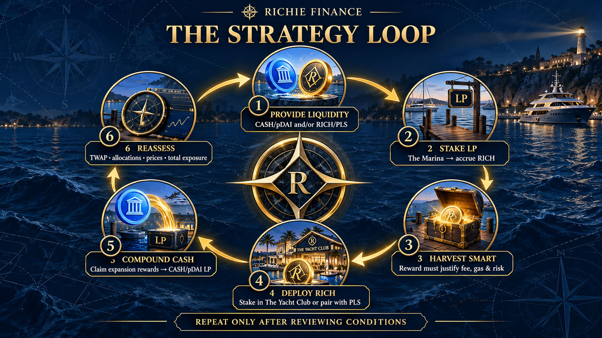

# Yield Strategy Guide

There is no single strategy that performs best in every market condition. Richie Finance offers several ways to participate, and the better approach depends on the **CASH/PDAI TWAP**, token prices, liquidity, PSM fees, lock periods, and your tolerance for risk.

This guide organizes the main opportunities by CASH's relationship to its target of **1 PDAI per CASH**. It is educational only, not financial advice, and no return or peg is guaranteed.

!!! info "Use the TWAP not only the live price"
    Protocol expansion decisions use the previous six-hour CASH/PDAI TWAP. The current PulseX price can move above or below the value used by the protocol for the current epoch.

## Quick strategy map

| Market zone | Protocol state | Potential focus |
| --- | --- | --- |
| **CASH TWAP at or above 1.01** | New CASH is minted | Stake RICH in The Yacht Club, farm protocol LPs, and compound selectively |
| **CASH TWAP from 1.00 to below 1.01** | Expansion is paused | Focus on farming LP incentives, trading fees, RICH accumulation, and liquidity management |
| **CASH TWAP below 1.00** | Contraction and peg-defense zone | Monitor redemption availability, manage CASH exposure carefully, and consider below-peg arbitrage only after checking capacity |

!!! warning "Bootstrap exception"
    The first 28 epochs of The Yacht Club use the configured bootstrap expansion schedule regardless of the CASH TWAP. After bootstrap, the zone rules described below apply.

## Zone 1: CASH TWAP at or above 1.01

When the six-hour TWAP is at least 1.01 PDAI, the protocol is mints new CASH during the next epoch. This is the environment in which RICH staking has the clearest direct reward opportunity.

### Potential approach

1. **Stake RICH in The Yacht Club.** New CASH is minted and distributed according to your share of the total RICH staked.
2. **Keep productive liquidity in The Marina.** CASH/PDAI and RICH/PLS LP positions continue to earn RICH incentives while also receiving their share of pool trading fees.
3. **Compare the PSM fee before harvesting.** RICH farm rewards require a PLS payment equal to the configured percentage of the reward value. The interface quotes the required PLS before you submit the claim.
4. **Compound selectively.** Harvested RICH can be staked in The Yacht Club or paired with PLS for the RICH/PLS pool. CASH seigniorage rewards can be held, paired with PDAI, or managed according to your risk plan.
5. **Plan around lock timers.** Depositing, withdrawing, or claiming in The Yacht Club resets the applicable lock period.

### What to watch

- A high displayed APR can fall as more RICH is staked or token prices change.
- CASH expansion increases supply and may place pressure on the CASH price.
- Selling every reward immediately may reduce the value of future rewards and weaken liquidity.
- RICH and LP-token prices can move more than the value of the rewards earned.

## Zone 2: CASH TWAP from 1.00 to below 1.01

In this range CASH is close to its target, but normal expansion is paused. Yacht Club participants should not assume that the next epoch will mint CASH.

### Potential approach

1. **Treat LP rewards and trading fees as the main active opportunities.** The Marina continues to distributing RICH even when CASH expansion is paused.
2. **Choose the exposure you actually want.** CASH/PDAI LP is primarily exposed to CASH and PDAI, while RICH/PLS LP is exposed to the more volatile RICH and PLS pair. Joining the CASH/PDAI LP close to peg reduces your impermanent loss chances should it continue to stay around peg value.
3. **Accumulate or stake RICH carefully.** RICH can be positioned for future expansion epochs, but rewards do not begin merely because it is staked.
4. **Keep claim costs efficient.** Consider PSM fees, PulseChain gas, price impact, and the size of the pending reward before harvesting and compounding.
5. **Maintain flexibility.** Holding some unstaked PDAI or PLS can make it easier to rebalance positions or pay future PSM fees without selling at an inconvenient time.

### What to watch

- The live price may cross 1.01 before the six-hour TWAP does.
- LP returns can be offset by impermanent loss.
- RICH staking may produce no CASH while expansion remains paused.
- Pool APR is variable and should not be treated as a fixed interest rate.

## Zone 3: CASH TWAP below 1.00

Below 1.00, normal CASH expansion is paused and the protocol can make funded CASH-to-PDAI redemptions available. This zone can create an arbitrage opportunity, but it also carries the greatest peg and liquidity risk.

### Potential approach

1. **Check whether redemptions are profitable and funded.** Do not assume that every CASH token can immediately be redeemed.
2. **Compare the complete trade.** A below-peg CASH purchase is only attractive if the expected redemption value exceeds PulseX price impact, fees, gas, waiting time, and execution risk.
3. **Use the Redemption Dock deliberately.** When capacity is available, CASH can be redeemed for PDAI at the configured 1:1 ratio, reducing circulating CASH supply and giving redeemers profitable arbitrage opportunities.
4. **Manage LP exposure.** CASH/PDAI liquidity continue to earn fees and RICH incentives, but a continuing depeg can leave the position holding more CASH.
5. **Avoid relying on immediate recovery.** Treasury support and redemptions depend on accessible reserves, realized revenue, settings, and market conditions.

### What to watch

- Redemption capacity can be limited or exhausted. Redemptions are on a FCFS basis.
- CASH is not a fully collateral-backed stablecoin.
- A low market price alone does not make an arbitrage profitable.
- Below-peg conditions can persist longer than expected.

## A practical compounding loop

One possible growth loop is:

1. Provide CASH/PDAI and/or RICH/PLS liquidity.
2. Stake the LP tokens in The Marina to earn RICH.
3. Harvest when the net reward justifies the fee, gas, and transaction risk.
4. Stake some RICH in The Yacht Club for CASH seigniorage rewards, or pair it with PLS and add it back to the RICH/PLS position.
5. If staked in The Yacht Club claim CASH expansion rewards and compound more CASH/PDAI LP.
6. Reassess the CASH TWAP, pool allocation, token prices, and total exposure before repeating.

Compounding can increase both potential returns and the amount of capital exposed to smart-contract, token-price, liquidity, and peg risk. 

## Compare the main earning routes

| Route | What you provide | What you may receive | Important costs and risks |
| --- | --- | --- | --- |
| CASH/PDAI in The Marina | CASH/PDAI LP tokens | RICH incentives and LP trading fees | PSM fee on RICH claims, impermanent loss, CASH peg risk |
| RICH/PLS in The Marina | RICH/PLS LP tokens | RICH incentives and LP trading fees | PSM fee on RICH claims, volatile pair exposure, impermanent loss |
| RICH in The Yacht Club | Staked RICH | Newly minted CASH during eligible epochs | Lock timers, inactive expansion periods, RICH and CASH price risk |
| Below-peg redemption | CASH while redemptions are funded | PDAI at 1:1 redemption ratio | Limited capacity, trade costs, execution risk |
| Treasury rebates | An approved PulseChain asset | Discounted RICH that vests over time | Vesting exposure, changing RICH price, rebate availability |

## Before committing capital

- Confirm you are using the official contracts and interface.
- Read the current [parameters and fees](../information/parameters-and-fees.md).
- Understand [supply, epochs and expansion](../protocol/supply-and-epochs.md).
- Review how [The Marina](../protocol/liquidity-farms.md), [The Yacht Club](../protocol/rich-staking.md), and the [PSM](../mechanisms/peg-stability-module.md) work.
- Read the full [risks and security](../information/risks-and-security.md) page.
- Start with a position size you can afford to lose.

The most sustainable approach is usually the one that still makes sense after accounting for every fee, lock, price movement, and downside scenario—not simply the pool displaying the highest APR.
